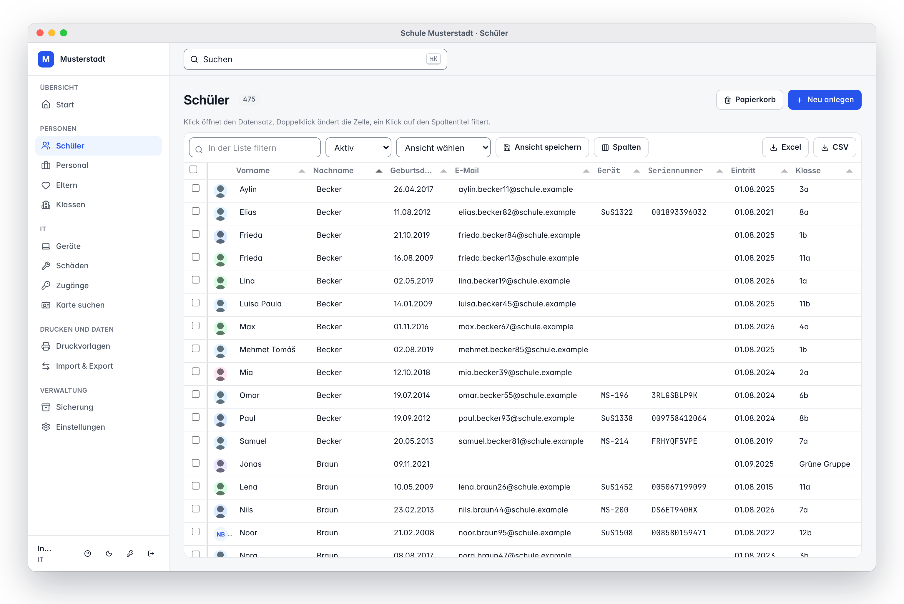
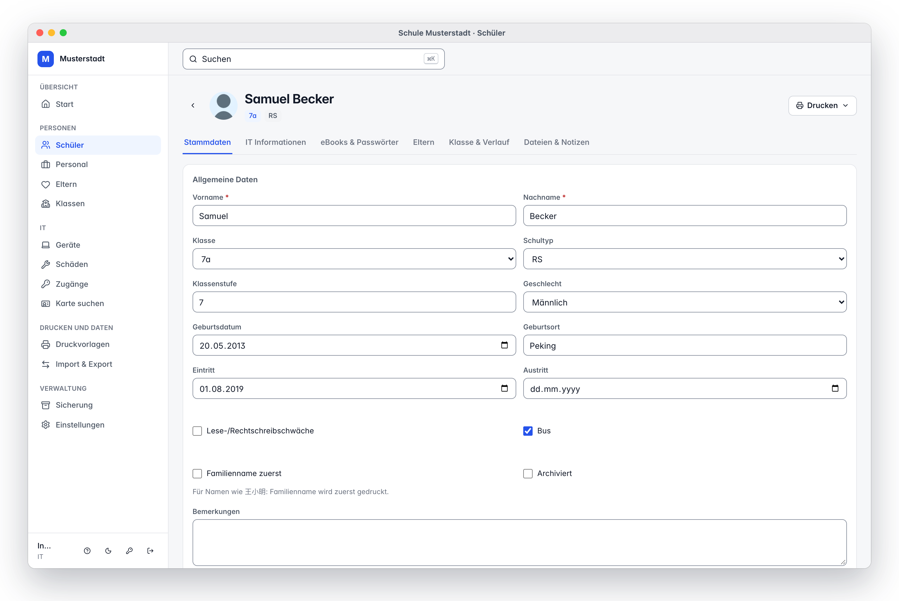

<p align="center"></p>
<h1 align="center">DataFluss</h1>
<p align="center">Your own database. On your computer, on your server, or both — always in sync.</p>
<p align="center">
  <a href="https://github.com/rana-gmbh/DataFluss/releases/latest">Download</a> ·
  <a href="#quick-start">Quick start</a> · <a href="#modules">Modules</a> · <a href="#run-a-server">Server</a> ·
  <a href="docs/BUILD.md">Build from source</a>
</p>



## What is DataFluss?

DataFluss keeps structured data — people, classes, devices, logins — in databases you own.

- **Works offline.** Every database lives on your Mac or PC, encrypted.
- **Syncs when you want.** Connect a database to a DataFluss server and changes flow both ways, also
  after days without a connection.
- **Starts from a module.** Begin with *Schulverwaltung* (school administration) and shape it with your
  own fields, forms and print templates.
- **Prints well.** Design ID cards, lists and letters, and print them as PDF.
- **Open source** under the AGPL-3.0.

| | |
|---|---|
|  |  |

## Download

| | |
|---|---|
| macOS (Apple silicon) | `DataFluss-<version>.dmg` of the [latest release](https://github.com/rana-gmbh/DataFluss/releases/latest) |
| Windows 10/11 (x64) | `DataFluss-<version>-setup.exe` of the [latest release](https://github.com/rana-gmbh/DataFluss/releases/latest) |
| Server | the Docker image `ghcr.io/rana-gmbh/datafluss` ([how](docs/server.md)) |

The apps update themselves. Server and apps always carry the same version number.

## Quick start

1. Install and open DataFluss. A short welcome explains the four ways in.
2. Click **Mit erfundenen Daten ausprobieren** to look around with invented people, or **Neue Datenbank**
   to start your own.
3. Pick a starting point, such as *Schulverwaltung*, name your database and create the first account.
   A short tour shows you where everything is; it is under **Hilfe** whenever you want it again.


## Modules

A module brings ready-made sections, forms, print templates and sample data.

| Module | Contains | |
|---|---|---|
| **Schulverwaltung** | Overview, people (pupils, staff, parents, classes), IT (devices, repairs, logins), printing and data exchange, administration | Included |
| Further basic modules | Planned, on a table builder for your own databases | Included |
| Private modules | Built for one organisation, delivered as signed add-ons by its server | On request |

How modules plug in, and how a signed module reaches the computers of an organisation: [docs/modules.md](docs/modules.md).

## Run a server

A server lets several people and computers work on the same data. It is the same application, in a
browser, plus sync for the apps. See [docs/server.md](docs/server.md) for Docker Compose and Coolify.

## How it fits together

```
[ DataFluss on a Mac ]  ⇄  [ DataFluss server ]  ⇄  [ DataFluss on a PC ]
   local, encrypted          web app and sync          local, encrypted
```

## Security

Databases are encrypted on disk (SQLCipher); keys stay in the macOS Keychain or the Windows Credential
Manager. Sign-in uses two-factor authentication. Updates and modules are signed. Please report
vulnerabilities as described in [SECURITY.md](SECURITY.md).

## Languages

German, English, Simplified and Traditional Chinese.

## Contributing

Bug reports and ideas are welcome as issues. Pull requests need a signed contributor agreement; see
[CONTRIBUTING.md](CONTRIBUTING.md).

## License

AGPL-3.0, see [LICENSE](LICENSE). © Rana GmbH
